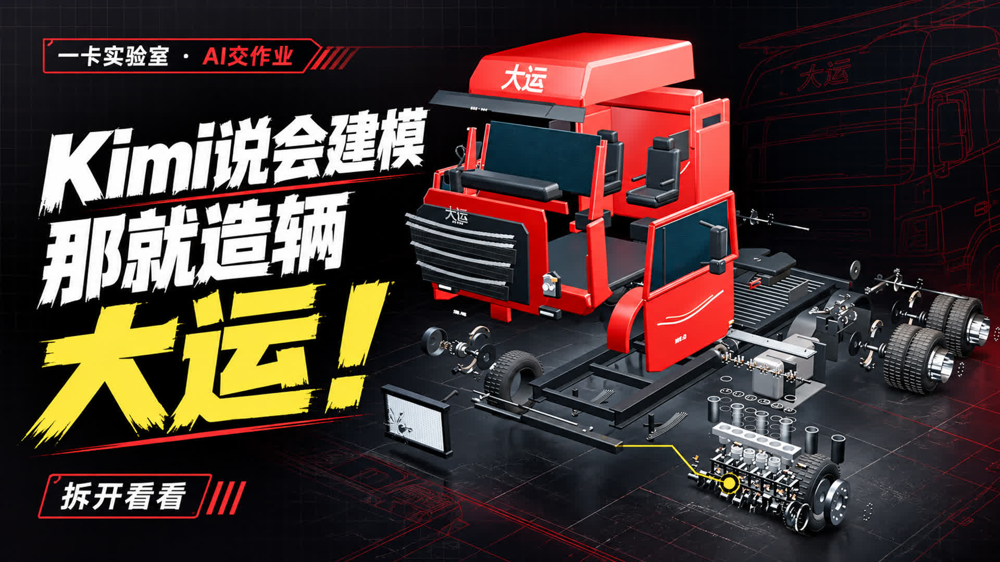
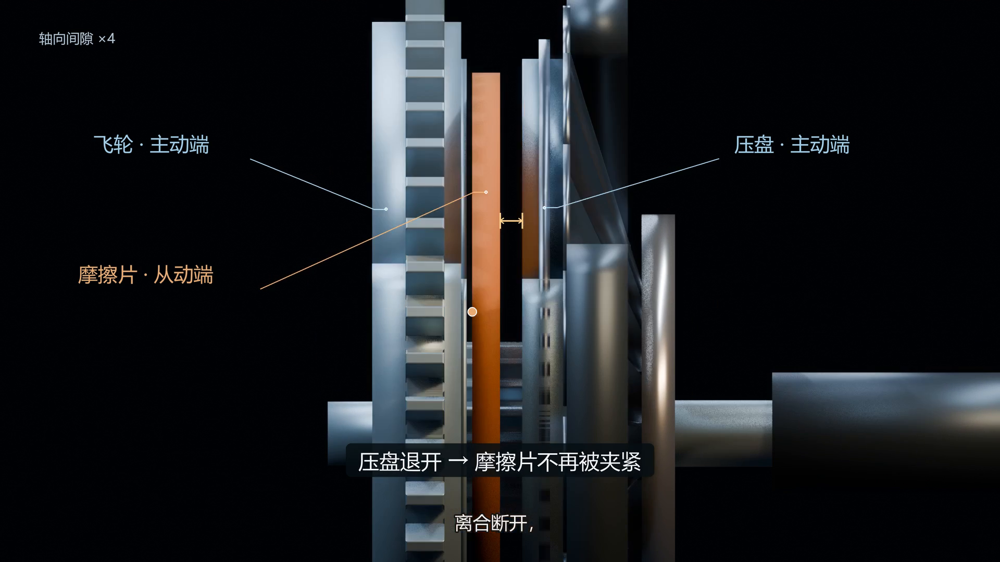

# 一卡实验室 · AI交作业 01：Kimi造大运

给 Kimi Code 出一道题：造辆能跑、能拆的大运。拆到活塞环、连杆、轴瓦和离合，再把零件装回去。



## 制作分工

**本期从选题到上传，由 Astra 主导。** Astra 通过 Codex 统筹选题策划、任务拆解、提示与反馈、质量检查、摄影剪辑、封面与章节包装、工程整理和投稿。

| 参与者 | 具体工作 |
|---|---|
| Kimi Code · K3.1 Pro | 车辆和精细机械建模，原始拆装及传动动画，原始碰撞试验，离合机构返工 |
| Astra / Codex | 制作统筹、检验、原始脚本生成过程回放、新增十二关碰撞场景、摄影、剪辑和包装 |
| Gemini 4 Argon · Vertex AI | 整稿审改和音画检查 |
| Gemini 3.8 Flash TTS | 旁白配音 |

## 下载与运行

[下载 Blender 模型与碰撞场景](https://github.com/holdonyb/yika-lab-kimi-dayun/releases/tag/v5.1)

1. 克隆本仓库。
2. 下载 Release 中的 `dayun-blender-assets-v5.1.zip`，解压到仓库根目录，保持 `pilots/` 路径。
3. 使用 Blender 5.1 打开下面的 `.blend` 文件。需要运行 Python 验证时，使用 Blender 内置 Python。

| 看什么 | 文件 |
|---|---|
| 细化后的整车 | `pilots/dayun/v3-kimi-run/truck_systems.blend` |
| 全零件展开 | `pilots/dayun/v3-kimi-run/p1_explosion.blend` |
| V5.1离合近景 | `pilots/dayun/v4-clutch-fix/clutch_mechanism.blend` |
| V5.1整条动力链 | `pilots/dayun/v4-clutch-fix/clutch_powertrain.blend` |
| 十二关碰撞 | `pilots/reboot_20261026/edit_show_v5/collisions/<关卡>/scene.blend` |
| 黑框冲屏 | `pilots/reboot_20261026/edit_show_v5/collisions/breakout/scene.blend` |

### 重建离合机构

```sh
blender --background --python pilots/dayun/v4-clutch-fix/build_clutch_fix.py -- build
blender --background --python pilots/dayun/v4-clutch-fix/validate_clutch.py
```

逐帧检查飞轮、摩擦片、压盘的实际间隙、主动/从动端转动以及接触时序。这里的离合采用几何和运动学教学模型，轴向间隙按4倍显示。



### 生成近景与标注

```sh
blender --background --python pilots/reboot_20261026/edit_show_v5/clutch_revision_v1/render_patch_frames.py -- all
python -m pip install -r requirements.txt
python pilots/reboot_20261026/edit_show_v5/clutch_revision_v1/annotate_patch.py all
```

标注随实际网格投影，转动参照点来自网格顶点。原制作环境为 Windows 11、Blender 5.1、FFmpeg 7.1.1、Pillow，中文使用系统微软雅黑；其他系统可把脚本中的字体路径换为本机中文字体。

### 十二道整活关卡

下次一定、最终版文件夹、99%进度条、DDL日历、ERROR墙、显存条、快递箱、弹幕墙、再改亿版、香蕉皮多米诺、点赞投币收藏、金色大饼。碰撞目标使用 Blender 刚体，车辆碰撞代理按设定轨迹行驶。

## 用量与版本

整车定稿输出725,369 token；离合返工新增84,255，累计输出809,624。输入含重复缓存读取，详见 [用量统计](docs/token-usage.json)。

公开版本保留脚本和资产的原始SHA来源记录，机器本地目录已改为仓库相对路径。离合使用本片采用的19:53冻结版本。[文件来源记录](docs/provenance.json)。

## 音乐与画面

片尾音乐：《天真的橡皮》白水寒版，完整歌曲1.5倍速。[音源条目](https://www.youtube.com/watch?v=Pl84iZnLRDA)。其他底乐和音效为原创合成。过程段包含原始Kimi脚本重跑生成的阶段回放。

本仓库下载内容为脚本、模型、场景和检查记录；完整影片见本期B站投稿。
